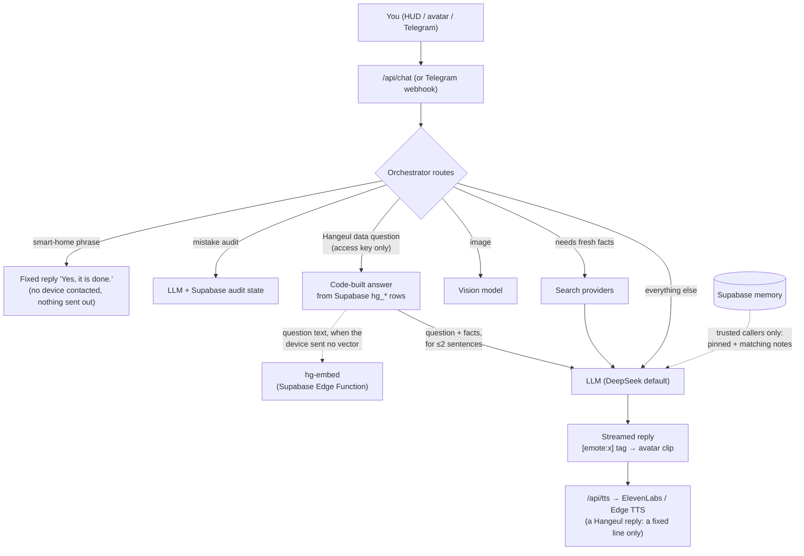
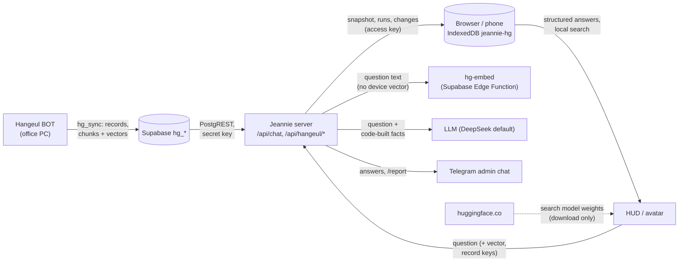

# Data flow: what Jeannie collects, where it goes, and why

**In plain words:** Jeannie only knows what you give her: what you type or say, pictures you show her,
notes you upload, and Telegram messages from the admin chat. To answer, she sends your message to an AI
company's model (DeepSeek by default), sometimes to a web search company, and her reply text to a voice
company. Jeannie itself stores only your uploaded notes and a little audit bookkeeping, in your Supabase
database. Chat history lives only in the open browser tab. She also **reads** the agency's student records,
which Hangeul BOT (a separate program on the office PC) publishes to the same Supabase project. Those hold
full student personal data, unmasked: with the access key, a full copy is kept on each browser or phone that
syncs, and the facts behind an answer go to the AI model so it can phrase them. They never go to the voice
company. Risks are listed at the end.

## 1. What is collected, by input

| Input | Collected where | Sent to | Stored? |
|---|---|---|---|
| Typed chat message | HUD / avatar screen | `/api/chat` → LLM provider | No. The browser tab keeps the conversation in memory only; the server keeps nothing |
| Image (upload or camera frame) | `CameraScanner`, file picker; downscaled to ≤1280 px JPEG in the browser (`lib/client/image.ts`) | `/api/chat` → vision model | No |
| Voice (microphone) | Browser Web Speech API (`useSpeechRecognition.ts`) | The **browser vendor** turns it into text (Chrome uses Google's servers); only the text reaches Jeannie | No (Jeannie never receives audio) |
| Jeannie's spoken reply | Reply text, shortened for speech (`lib/client/speech-text.ts`); a Hangeul reply is replaced by a fixed line | `/api/tts` → ElevenLabs, or Microsoft Edge TTS; else the browser speaks it locally | No |
| Uploaded notes (`.md`, `.jsonl`, ≤1 MB) | Memory panel or `npm run memory:upload` | `/api/memory` → Supabase | **Yes**, until you delete them |
| Telegram message or photo | Telegram → `/api/telegram/webhook` | Admin chat only: orchestrator → LLM / vision model; photos downloaded from Telegram for that one answer | Only audit approval state (see §3) |
| Hangeul question | HUD / avatar screen / Telegram admin chat. On the device, `hg-local/ask.ts` may answer it from the local copy, or embed it locally for search | Nothing, when the device copy answers. Otherwise `/api/chat` (with the device's question vector and top record keys, if any) → Supabase reads; `hg-embed` (the question text, only when no device vector came); the LLM (the question and the code-built facts) | No |
| Student records (Hangeul BOT's data) | Not collected by Jeannie: Hangeul BOT reads the portal and writes Supabase `hg_*` | Jeannie's server → each browser that syncs with the access key; facts for an answer → the LLM; answers in the Telegram admin chat | **Yes**: in Supabase (kept current by the bot) and in each syncing browser's IndexedDB until "Delete local copy" |
| "How long were you away" | `localStorage` timestamp (`useLastSeen.ts`) | `/api/session?awayMs=` → LLM, for the greeting | In the browser only |
| Access key | Typed once into the access dialog | Every `/api` request header | In the browser's `localStorage` |

Nothing collects location (`Permissions-Policy` blocks geolocation), contacts, or files you did not pick.

## 2. Where each flow goes, and why

A structured Hangeul question can also be answered on the device from its IndexedDB copy, with no request at
all (see [Hangeul data](#hangeul-data-student-records)).

| Flow | Path in code | Leaves to | Why |
|---|---|---|---|
| Chat answer | `api/chat/route.ts` → `agents/orchestrator.ts` → `agents/llm.ts` | DeepSeek, or Anthropic / OpenAI / an OpenAI-compatible URL / Ollama, whichever is configured | The model writes the answer. It receives the last 20 messages, the system prompt (persona, time, recalled memory) and any tool results |
| Image | `orchestrator.ts` `runVision` → `agents/vision-agent.ts` | Claude or OpenAI if their key is set, else DeepSeek's vision model | DeepSeek's chat model cannot read images |
| Live search | `agents/search-agent.ts` | DeepSeek web search → Tavily → Google CSE → DuckDuckGo (first that works) | Fresh facts the model cannot know. Only the search query is sent (the model may rewrite it from recent turns) |
| Read a web page | `agents/read-url.ts` | `r.jina.ai` (renders the page), else a direct fetch | The model asked to read a URL. Private / localhost addresses are refused |
| Time questions | `agents/time-tools.ts` | Nothing | Pure date arithmetic |
| Smart-home phrase | `agents/iot-interceptor.ts` | Nothing | Hard rule: answered with a fixed sentence, no device is contacted |
| Memory recall | `memory/store.ts` `recallMemory` | Supabase (read), then into the LLM prompt | Personal context. Only for **trusted** callers (valid access key, cron secret, or Telegram admin chat); up to 3 pinned notes (≤3,000 chars) plus up to 6 full-text matches |
| Greeting | `api/session` → `agents/greeting.ts` | LLM | A short Korean opening line for the time of day and how long you were away (one recalled item for trusted callers) |
| Voice | `api/tts` → `agents/tts-engine.ts`, `agents/edge-tts.ts` | ElevenLabs, else Microsoft Edge (`speech.platform.bing.com`) | Natural voice; the browser voice is the free fallback |
| Hangeul answer | `orchestrator.ts` `runHangeul` (or `api/hangeul/ask`) → `hangeul/respond.ts` → `hangeul/answer.ts` + `hangeul/store.ts` | Supabase (reads `hg_*` over PostgREST); `hg-embed` (the question text, for search, when the device sent no vector); the LLM (the question, the conversation, recalled notes, and the code-built facts as JSON, up to 20 rows per table, **personal data included**; a Korean/Bangla search question alone, to rewrite it into English) | Questions about students, payments, consultations, documents, reports. Code computes every figure; the model adds at most two sentences, dropped if they hold a number the facts do not. Only with the access key set and presented, or in the Telegram admin chat |
| Hangeul device sync | `useHangeulLocal` → `hg-local/sync.ts` → `/api/hangeul/snapshot`, `/runs`, `/changes` | Supabase → Jeannie's server → the browser's IndexedDB (`jeannie-hg`) | Faster answers while online (never offline answers). A structured question answered from the copy sends nothing anywhere |
| Device search model | `hg-local/embed.worker.ts` | Model weights downloaded once from huggingface.co (nothing is sent but the download request); the question is embedded on the device | Local semantic search; only the vector and the top record keys go to the server |
| Hangeul daily brief | Telegram `/report` → `telegram.ts` → `answerHangeul` with no model | Telegram admin chat | The daily brief on demand (there is no scheduled push) |
| Hangeul status | `api/hangeul`, `api/status` (with the key) | Supabase (read); nothing else | Record count, last runs, latest report keys and times; no student data |
| Telegram | `api/telegram/webhook` → `telegram.ts` | Telegram Bot API (replies), and the same LLM/search flows as chat | Use Jeannie from Telegram. Non-admin chats get a "private" line and nothing else; with no admin chat set, nothing costly runs |
| Status | `api/status` | Nothing | Tells the page which features are on (booleans and model names only) |

## 3. What is stored in Supabase today

Every table has row-level security on with **no policies**, and the public `anon`/`authenticated` roles are
revoked. Only the server's secret key can read or write (`supabase/migrations/*`).

| Table | Holds | Written by | Kept |
|---|---|---|---|
| `memory_documents` | One row per uploaded note: file name, title, kind, pinned, full text, size | `/api/memory` (upload replaces a same-name file) | Until deleted in the Memory panel |
| `memory_chunks` | The note split into searchable pieces (heading, text, keywords; full-text index) | Same, via `upsert_memory_document` | Deleted with the note |
| `jeannie_sessions` | Per Telegram chat (`telegram:<chat id>`): idle or awaiting approval, and the pending audit reply | Telegram mistake-audit flow | Overwritten each time; a pending reply older than 30 minutes is ignored |
| `jeannie_audit_log` | Each approve/reject decision: chat key, decision, the audited items | Telegram audit flow | Kept indefinitely |
| `hg_runs`, `hg_records`, `hg_chunks`, `hg_changes` | The agency's student records, reports and the bot's runs ([details](#hangeul-data-student-records)) | Hangeul BOT through `hg_sync` (`hg_changes` by a trigger); Jeannie only reads | The latest state of each record, kept current by the bot |

Upload guard: `memory/chunk.ts` refuses files that look like they contain secrets (API keys, GitHub / Slack /
Telegram tokens) or ID numbers (passport, NID, TIN, birth registration).

## 4. What stays on the device

| Where | What |
|---|---|
| `localStorage` | The access key (`lib/client/api.ts`), language and voice toggles, desktop layout and view mode, last-seen time, chosen outfit, whether this browser keeps the Hangeul copy |
| Service worker cache `jeannie-v4` | App shell, avatar clips, icons, Next.js static files. Never `/api` responses, so never student data |
| IndexedDB `jeannie-hg` | Only with the access key (and the server serving the Hangeul data): a **full copy** of the student records, chunk texts and vectors, the bot's runs and the sync state. Shared by every tab of the origin; removed only by "Delete local copy" in the Hangeul Sync panel |
| Cache Storage `transformers-cache` | The search model (gte-small, ~34 MB) and its WASM runtime; no student data |
| Memory of the open tab | The chat conversation (lost on reload) |

## 5. Third parties that receive data

| Service | Receives | When |
|---|---|---|
| DeepSeek (default model) | Messages, system prompt with recalled notes, tool results, images (vision fallback), search queries; for a Hangeul answer, the code-built facts (student personal data included) | Every model answer |
| Anthropic / OpenAI / custom OpenAI-compatible endpoint / Ollama | Same as above | Only if configured instead of, or alongside, DeepSeek |
| Tavily, Google Custom Search, DuckDuckGo | Search queries | Search turns |
| Jina Reader (`r.jina.ai`) | URLs the model reads | When the model reads a page |
| ElevenLabs, Microsoft Edge TTS | Reply text (spoken part); never a Hangeul answer (a fixed line is spoken instead) | When the server voice is on |
| Browser vendor (e.g. Google for Chrome) | Microphone audio | While you hold to talk |
| Telegram | Messages and replies in the admin chat, including Hangeul answers and `/report` | Telegram use |
| Supabase | Uploaded notes, audit state; the Hangeul data (written by Hangeul BOT, read by Jeannie); question text sent to `hg-embed` | Memory, audit and Hangeul features |
| Hugging Face (`huggingface.co`) | A download request for the search model's weights (no question or record text) | The first time a browser loads the search model |
| Vercel | All requests pass through its functions (logs carry error names only) | Always |
| Hangeul portal | Nothing from Jeannie: only Hangeul BOT, outside this app, talks to it | Never |

## Hangeul data (student records)

> **Status: built.** Hangeul BOT publishes to the tables of migration `20260929030000_hangeul_context.sql`;
> Jeannie reads them (`src/lib/hangeul/`, `src/lib/client/hg-local/`).
> Source: `.scratch/hangeul-cloud-context/spec.md`.

**Goal:** answer questions about the agency's students from the phone instantly, without the office PC
being awake.

**Who can read it:** only a caller presenting `JEANNIE_ACCESS_KEY`, which must be set (an open deployment
serves none of it, and `CRON_SECRET` never unlocks it), and the Telegram admin chat.

**Path:**

1. Hangeul BOT on the office PC reads `hangeul.com.bd/admin` (student lists, profiles, payments, passport
   audits, document checks with their OCR text, consultations, calendar items, reports). Jeannie never talks to
   the portal.
2. The bot publishes every parsed field, **unmasked**, to Supabase through `hg_sync`, with `gte-small`
   embeddings of each record's text.
3. Jeannie's server reads the rows over PostgREST with the server-only key (`hangeul/store.ts`); it never
   writes them.
4. With the access key, the web app keeps a **full copy** (records, chunk texts, vectors) in IndexedDB
   (`jeannie-hg`), for speed while online: a first sync through `/api/hangeul/snapshot` (it asks first on
   mobile data), then `/runs` and `/changes` on open, on focus and every 5 minutes. Never in the service
   worker cache, never used offline. "Delete local copy" is the only way to remove it from a device.
5. Code builds the facts for each answer (`hangeul/answer.ts`), on the device or on the server. A
   device-built answer sends nothing anywhere. A server answer sends the model the question, the
   conversation, recalled notes and the code-built facts, **personal data included**, for at most two
   sentences around them (spec decisions D2, D9, D11); Telegram `/report` uses no model.
6. For search, the question is embedded on the device (weights downloaded once from huggingface.co, runtime
   from Jeannie's own `/ort/`), or by `hg-embed` from its text when no device vector came.
7. Hangeul replies are **never** sent to the voice engines: the page speaks a fixed line instead
   (`lib/client/speech-text.ts` `spokenText`).
8. Every answer ends with an "as of" time taken from the bot's runs (`hg_runs`).

**Tables:**

| Table | Holds |
|---|---|
| `hg_runs` | One row per bot job: job name, start/end, status, counts |
| `hg_records` | Latest state of every entity, keyed by `(kind, key)`: `student_uid`, `student_hng_id`, `student_name`, `passport_no`, `day`, `data` (every parsed field), `content` (text form), `source`, `read_at` |
| `hg_chunks` | Each record's text in chunks, with 384-dimension `gte-small` embeddings, for semantic search |
| `hg_changes` | Change log (filled by a trigger) for syncing devices |

Record kinds (`HG_KINDS` in `src/lib/hangeul/types.ts`): `student`, `student_export`, `student_profile`,
`student_progress`, `student_documents`, `verification`, `consultation`, `consultation_day`,
`consultation_totals`, `pending_payment`, `window_application`, `dashboard_fact`, `calendar_item`,
`passport_audit`, `passport_alert`, `passport_issue`, `doc_verdict`, `doc_check`, `field_check`,
`field_correction`, `doc_page_text`, `report`, `report_section`, `brief_fact`, `notification` and
`consultant_performance`.

**Example rows. FAKE: example only. No real person.**

| kind | key | student_hng_id | student_name | passport_no | day | data (excerpt) |
|---|---|---|---|---|---|---|
| `student` | `0` | `HNG-0000-0` | TEST STUDENT | `X0000000` | — | `{"phone": "+880 1700-000000", "dob": "2000-01-01", "father": "TEST FATHER", "status": "FAKE"}` |
| `verification` | `0` | `HNG-0000-0` | TEST STUDENT | `X0000000` | `2000-01-01` | `{"verifier": "TEST", "amount": 0, "method": "FAKE"}` |

## Risks and suggested fixes

| # | Risk | Today / planned | Suggested fix |
|---|---|---|---|
| 1 | **One shared access key.** Anyone with it can use the chat, read and delete all memory notes, and read every student record (and sync a full copy to their device). It sits in `localStorage` on each device that entered it | Today | Rotate it if it was ever shared or pasted (Vercel env var, then redeploy). Longer term: per-device keys or a real login (the spec chose not to, D8) |
| 2 | **API is open if `JEANNIE_ACCESS_KEY` is unset.** Chat, search and voice then work for anyone who finds the URL (billing exposure), though memory and the Hangeul data stay locked (the Hangeul routes answer 403) | Today | Always set the key on any public deployment |
| 3 | **Notes go to the model provider.** Recalled notes are part of the prompt sent to DeepSeek (or whichever provider) | Today | Keep sensitive notes out of memory; the upload guard only catches obvious keys and ID numbers |
| 4 | **Full student personal data in several places, unmasked**: Supabase, each syncing browser's IndexedDB, the model provider's prompts, and the Telegram admin chat when asked there (never the voice engines) | Today | Consider masking passport and phone in prompts, encrypting the device copy, and a retention limit. The spec records these as accepted risks |
| 5 | **A leaked key cannot claw back synced data.** Rotation stops new reads (a 401 stops the sync), but a copy already on a device stays until "Delete local copy" is pressed there | Today | Add a wipe: the app clears its local copy whenever the server answers 401 (key rotated) |
| 6 | **Third-party retention.** DeepSeek, ElevenLabs, search providers and Jina keep data under their own policies | Today | Review each provider's data-retention settings; use a provider with zero-retention terms for sensitive turns |
| 7 | **Secrets exposed in chats.** The spec notes the office PC's `.env` and a Google token were pasted in chats and rotation was deferred | Today | Rotate those secrets |
| 8 | **`jeannie_audit_log` grows forever** | Today | Add a retention period if it starts holding sensitive items |
| 9 | **No CI.** A bad push reaches preview without automatic checks; production only on merge | Today | Add a GitHub Action running typecheck, lint, test and build on every PR |
| 10 | **`/api/status` is open** | Today, by design | Fine: it returns only booleans and model names, never secrets |
