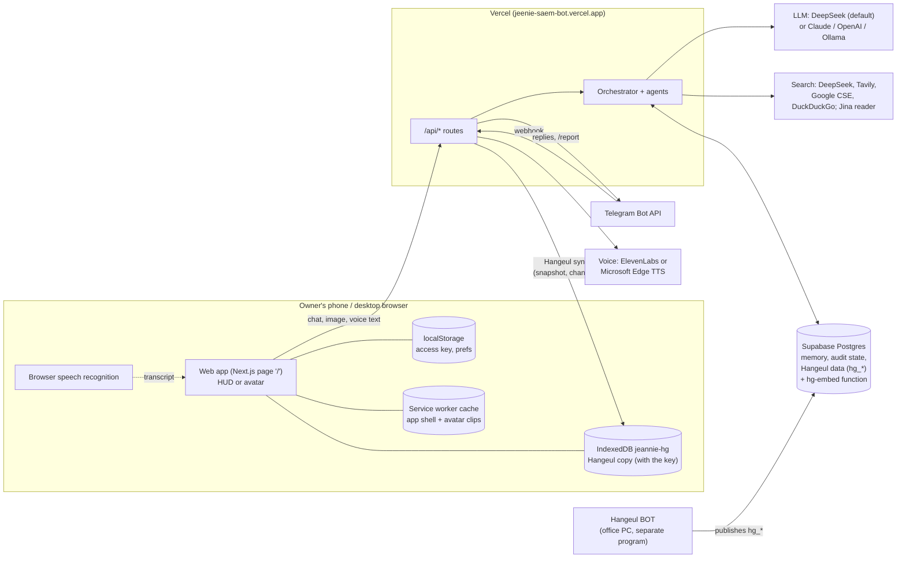

# Overview

**In plain words:** Jeannie is a private, bilingual (Korean and English) assistant for one person, the
owner, addressed as 부장님 (or 자기야 in personal moments). You talk to her in a web app: on a phone she is
an animated avatar, on a desktop a "HUD" control screen. She can chat, read pictures, search the web, speak,
remember notes you upload, answer in Telegram, and answer questions about the agency's students from the
records Hangeul BOT (a separate program on the office PC) publishes to Supabase. The app runs on Vercel; her
"brain" is a language model (DeepSeek by default) reached over the internet.

## The moving parts

## What each part does

- **Web app** (`src/app/page.tsx`): one page. On phones it shows the avatar screen, on desktops the HUD
  (with a `1 | 2` switch between the classic HUD and the avatar). It is installable as a PWA; offline it shows
  a banner and disables the input (there are no offline answers).
- **API routes** (`src/app/api/*`): the server side. Chat, greeting, search, voice, memory, the Hangeul data
  (status, device sync, answers), Telegram webhook and a public status check. See [site-map.md](site-map.md).
- **Orchestrator** (`src/lib/agents/orchestrator.ts`): decides which specialist answers each message
  (smart-home, mistake audit, Hangeul, vision, live search, or the core chat agent) and streams the reply.
- **Memory** (`src/lib/memory/*`, Supabase): notes the owner uploads; relevant ones are added to the model's
  instructions for trusted callers.
- **Avatar** (`src/lib/avatar/*`, `public/avatar/*`): pre-rendered video clips (Kling) driven by a small state
  machine; replies open with an `[emote:…]` tag that picks the clip. See [`../CONTEXT.md`](../CONTEXT.md).
- **Telegram** (`src/lib/telegram.ts`): the same assistant in a private admin chat, plus `/report` (the Hangeul
  daily brief, on demand).
- **Hangeul data** (`src/lib/hangeul/*`, `src/lib/client/hg-local/*`): Jeannie never talks to the Hangeul
  portal. Hangeul BOT reads it and publishes to Supabase (`hg_*` tables); Jeannie reads those rows, code builds
  every figure in an answer, and the model may add up to two checked sentences. With the access key the browser
  keeps a full copy in IndexedDB, for speed while online. Hangeul answers are never sent to the voice engines.
  See [data-flow.md](data-flow.md#hangeul-data-student-records).

## Who can use it

Everything except `/api/status` is behind one shared secret, `JEANNIE_ACCESS_KEY` (the HUD asks for it once).
The Hangeul data needs the key to be set **and** presented: an open deployment serves none of it.
Telegram only answers the one admin chat. Details and risks: [data-flow.md](data-flow.md#risks-and-suggested-fixes).
